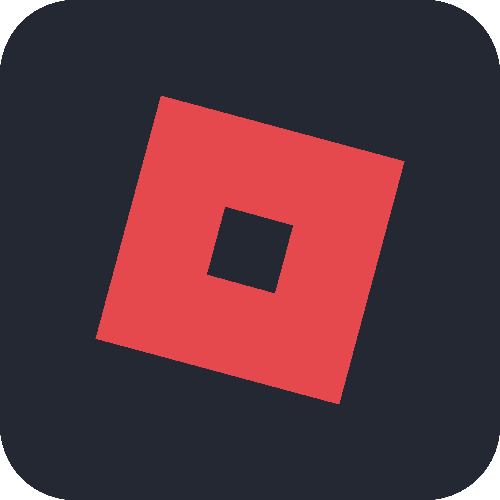

<p align="center">
  
</p>

<p align="center">
  A Linux launcher for Roblox Player and Studio, powered by Rovarch CORE.
</p>
<p align="center">
  <a href="https://github.com/RovarchHQ/Rovarch/releases/latest"></a>
  <a href="https://github.com/RovarchHQ/Rovarch/blob/main/LICENSE"></a>
  <a href="https://github.com/RovarchHQ/rovarch-core"></a>
</p>

## About

Rovarch is an independent Linux launcher designed to run Roblox Player and Studio natively on Linux through [Rovarch CORE](https://github.com/RovarchHQ/rovarch-core) (based on Rosemary).

Inside the launcher, the two products are presented as **Rovarch Play** (Roblox Player) and **Rovarch Studio** (Roblox Studio).

> [!NOTE]
> Rovarch is an independent, unofficial project. It is not affiliated with, endorsed by, or sponsored by Roblox Corporation.

## Install

Download `Rovarch-x86_64.AppImage` from the latest [release](https://github.com/RovarchHQ/Rovarch/releases), make it executable and run it:

```
chmod +x Rovarch-x86_64.AppImage
./Rovarch-x86_64.AppImage
```

Or install it to `~/.local/bin` and the app menu with:

```
curl -fsSL https://raw.githubusercontent.com/RovarchHQ/Rovarch/main/install.sh | bash
```

## Build from Source

Requirements: Git, Rust 1.85+, GTK4, gtk4-layer-shell, libadwaita, and clang (optional, for VR support).

```
git clone https://github.com/RovarchHQ/Rovarch.git
cd Rovarch
cargo build
```

## License

Rovarch is distributed under the [GNU General Public License v3.0](LICENSE).

---

<p align="center">
  © 2026 <a href="https://github.com/dratiux">Abdullah K.</a> • Released under the GPL-3.0 License
</p>
